| Name                 | NRP        | Kelas |
| -------------------- | ---------- | ----- |
| Ahmad Fakhrul Bawani | 5025251143 | B     |

> [!IMPORTANT]
> Remember to use the IP prefix allocation provided earlier for this pre-lab assignment (pra-praktikan) and for future ones.
> Access it on [Linktree](https://linktr.ee/jarkom)

> [!TIP]
> **Due Date : `5th November 2026, 23.00 WIB`**

#### Put your GNS3 Project files here (gdrive or github upload)!


---

# Bagian A - Reliable Data Transfer pada Kondisi Normal

## A.3 - Persiapan Topologi

> Langkah kerja, topologi, dan persiapan konfigurasi network (Pre-Praktikum). Seluruh pengujian pada Bagian A - D menggunakan topologi yang sama.
>
> _Work steps, topology, and network configuration preparation (Pre-Practicum). All tests in Parts A - D use the same topology._

#### Soal A.3.1 - Topologi GNS3

> Buat topologi sesuai gambar dan tabel pemetaan node.
>
> _Build the topology according to the figure and the node mapping table._

**Answer:**

<div align="center">
  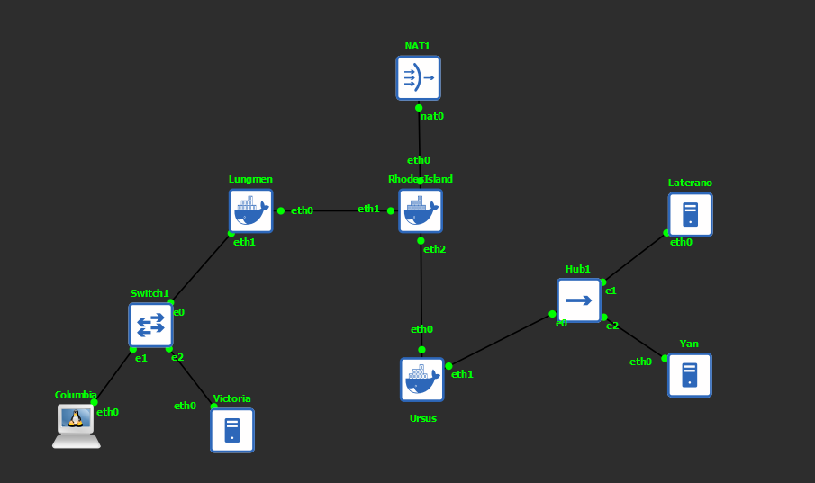
</div>

#### Soal A.3.2 - Konfigurasi IP / Network & Static Routing

> Tunjukkan konfigurasi `/etc/network/interfaces` tiap router (RhodesIsland, Lungmen, Ursus), command `ip route add` (dapat dikonfigurasikan otomatis melalui `init.sh`), hasil `ip route show` pada ketiga router, serta bukti ping antara Victoria dan Yan.
>
> _Show the `/etc/network/interfaces` config of each router (RhodesIsland, Lungmen, Ursus), the `ip route add` commands (can be automated through `init.sh`), the `ip route show` output on all three routers, and proof of ping between Victoria and Yan._

**Answer:**

1. Router RhodesIsland

```bash
# DHCP config for eth0
auto eth0
iface eth0 inet dhcp
	hostname RhodesIsland

# Static config for eth1
auto eth1
iface eth1 inet static
	address 10.127.1.1
	netmask 255.255.255.0

# Static config for eth2
auto eth2
iface eth2 inet static
	address 10.127.2.1
	netmask 255.255.255.0
```

Lalu membuat subnet dan buka komunikasi dengan nat agar dapat mengakses internet pada `/root/init.sh`:

```bash
# ip route add <new_ip_subnet> via <subnet_iface_ip> dev <subnet_iface>
ip route add 10.127.3.0/24 via 10.127.1.2 dev eth1
ip route add 10.127.4.0/24 via 10.127.2.2 dev eth2
iptables -t nat -A POSTROUTING -j MASQUERADE -s 10.127.0.0/16 -o eth0
```

2. Router Lungmen

```bash
auto eth0
iface eth0 inet static
    address 10.127.1.2
    netmask 255.255.255.0
    gateway 10.127.1.1

auto eth1
iface eth1 inet static
    address 10.127.3.1
    netmask 255.255.255.0
```

Lalu membuat konfigurasi subnet pada `/root/init.sh`:

```bash
# ip route add <new_ip> via <gateway_ip> dev <gateway_iface>
ip route add 10.127.2.0/24 via 10.127.1.1 dev eth0
ip route add 10.127.4.0/24 via 10.127.1.1 dev eth0
echo "nameserver 8.8.8.8" > /etc/resolv.conf
```

3. Router Ursus

```bash
auto eth0
iface eth0 inet static
    address 10.127.2.2
    netmask 255.255.255.0
    gateway 10.127.2.1

auto eth1
iface eth1 inet static
    address 10.127.4.1
    netmask 255.255.255.0
```

Lalu membuat konfigurasi subnet pada `/root/init.sh`:

```bash
# ip route add <new_ip> via <gateway_ip> dev <gateway_iface>
ip route add 10.127.1.0/24 via 10.127.2.1 dev eth0
ip route add 10.127.3.0/24 via 10.127.2.1 dev eth0
echo "nameserver 8.8.8.8" > /etc/resolv.conf
```

4. Setup ip address untuk node Yan dan Victoria

```bash
# Victoria
auto eth0
iface eth0 inet static
	address 10.127.3.2
	netmask 255.255.255.0
	gateway 10.127.3.1

# Yan
auto eth0
iface eth0 inet static
	address 10.127.4.2
	netmask 255.255.255.0
	gateway 10.127.4.1
```

Lalu lakukan ping 2 arah, hasilnya seperti ini:

<div align="center">
  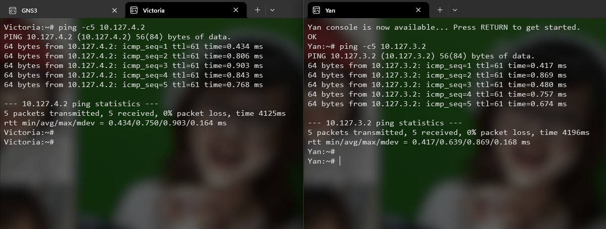
</div>

#### Soal A.3.3 - NAT dan DNS

> Tunjukkan aturan `iptables` MASQUERADE pada RhodesIsland (`-s [IP Prefix].0.0/16 -o eth0`), `nameserver 8.8.8.8` pada `/etc/resolv.conf` di semua node, dan bukti semua node (RhodesIsland, Lungmen, Ursus, Victoria, Yan) dapat `ping google.com`.
>
> _Show the `iptables` MASQUERADE rule on RhodesIsland (`-s [IP Prefix].0.0/16 -o eth0`), `nameserver 8.8.8.8` in `/etc/resolv.conf` on all nodes, and proof that all nodes (RhodesIsland, Lungmen, Ursus, Victoria, Yan) can `ping google.com`._

**Answer:**

1. Untuk semua node, tambahkan google public dns dengan menambah baris berikut ke dalam `/root/init.sh`:

```bash
echo "nameserver 8.8.8.8" > /etc/resolv.conf
```

2. Untuk RhodesIsland, tambahkan rule iptable pada `/root/init.sh`:

<div align="center">
  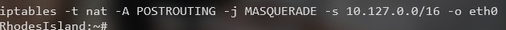
</div>

3. Lakukan ping ke google.com pada ke lima node tersebut. Hasilnya seperti ini:

<div align="center">
  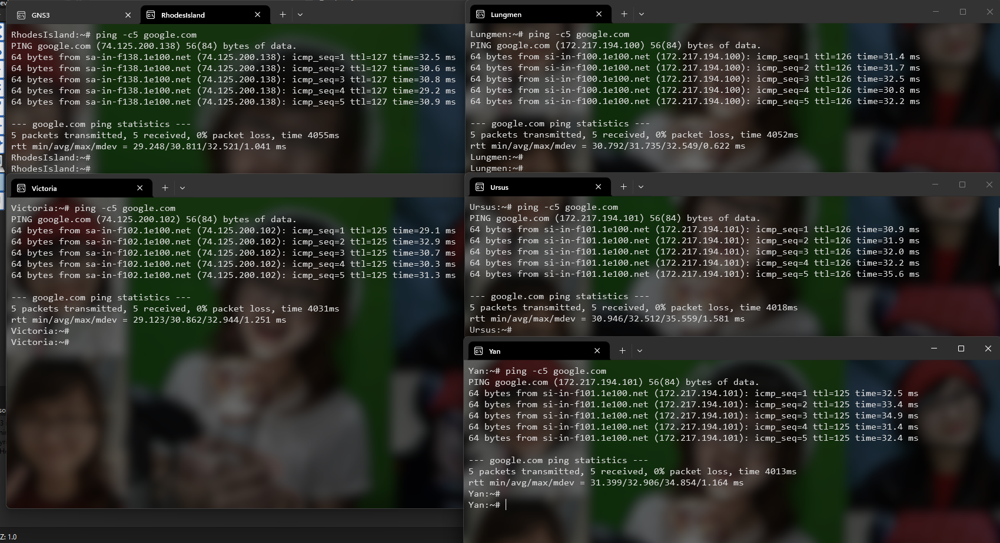
</div>

#### Soal A.3.4 - DHCP Server (kea-dhcp4) pada Yan dan Victoria

> Tunjukkan `/etc/kea/kea-dhcp4.conf` pada Yan (termasuk reservasi Laterano `[IP Prefix].4.15`) dan Victoria menggunakan kea-dhcp4 (bukan udhcpd), bukti `kea-dhcp4` berjalan, serta bukti lease client (`udhcpc -i eth0` dan `ip -br addr`) pada Laterano dan Columbia.
>
> _Show `/etc/kea/kea-dhcp4.conf` on Yan (including the Laterano reservation `[IP Prefix].4.15`) and Victoria using kea-dhcp4 (not udhcpd), proof that `kea-dhcp4` is running, plus client lease evidence (`udhcpc -i eth0` and `ip -br addr`) on Laterano and Columbia._

**Answer:**

Untuk node Yan dan Victoria:

1. Download `kea-dhcp4` server

```bash
apk update
apk add kea-dhcp4
```

2. Edit konfigurasi file kea-dhcp di `/etc/kea/kea-dhcp4.conf` pada Victoria:

```conf
{
  "Dhcp4": {
    "interfaces-config": {
      "interfaces": ["eth0"]
    },
    "lease-database": {
      "type": "memfile",
      "persist": true,
      "name": "/var/lib/kea/kea-leases4.csv"
    },
    "valid-lifetime": 3600,
    "max-valid-lifetime": 7200,
    "subnet4": [
      {
        "id": 1,
        "subnet": "10.127.3.0/24",
        "pools": [
          { "pool": "10.127.3.100 - 10.127.3.120" }
        ],
        "option-data": [
          { "name": "routers", "data": "10.127.3.1" },
          { "name": "domain-name-servers", "data": "8.8.8.8" }
        ]
      }
    ]
  }
}
```

3. Edit file konfigurasi pada Yan juga. Untuk bagian mac Laterano bisa dicek pada Laterano menggunakan `ip link show eth0`:

```conf
{
  "Dhcp4": {
    "interfaces-config": {
      "interfaces": ["eth0"]
    },
    "lease-database": {
      "type": "memfile",
      "persist": true,
      "name": "/var/lib/kea/kea-leases4.csv"
    },
    "valid-lifetime": 3600,
    "max-valid-lifetime": 7200,
    "subnet4": [
      {
        "id": 1,
        "subnet": "10.127.4.0/24",
        "pools": [
          { "pool": "10.127.4.50 - 10.127.4.60" }
        ],
        "option-data": [
          { "name": "routers", "data": "10.127.4.1" },
          { "name": "domain-name-servers", "data": "8.8.8.8" }
        ],
        "reservations": [
          { "hw-address": "02:42:48:c5:8e:00", "ip-address": "10.127.4.15" }
        ]
      }
    ]
  }
}
```

4. Cek file konfigurasi dengan `kea-dhcp4 -t /etc/kea/kea-dhcp4.conf`
5. Buat direktori yang dibutuhkan kea:

```bash
mkdir -p /var/lib/kea /run/kea
```

6. Run Kea dhcp di foreground

```bash
kea-dhcp4 -d -c /etc/kea/kea-dhcp4.conf
```

<div align="center">
  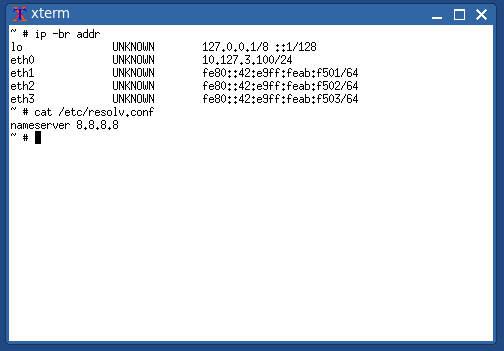 <br />
  <p>Columbia mendapatkan ip dan nameserver</p> <br />
  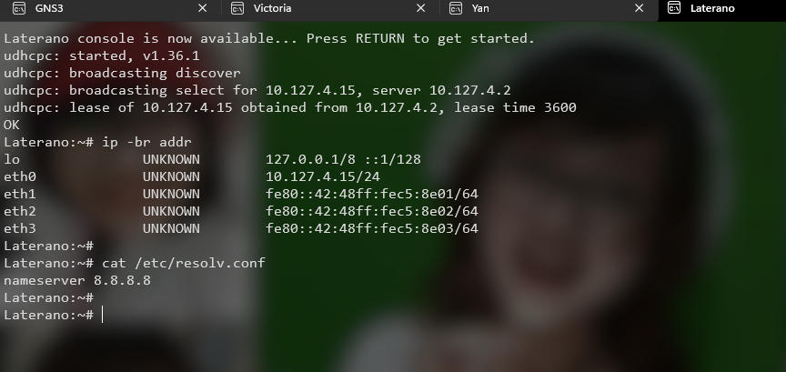 <br />
  <p>Laterano mendapatkan ip dan nameserver</p><br />
</div>

#### Soal A.3.5 - HTTP Server pada Laterano

> Pastikan Yan dan Laterano terhubung ke internet dan python3 sudah terpasang di Laterano (seperti modul 2). Tunjukkan `/root/myscripts/start_http.sh` yang dijalankan di tmux (split window) serta pembuatan berkas uji dengan `dd` (`tes1000.bin`, `tes10000.bin`, `tes50000.bin`, `tes5M.bin`).
>
> _Make sure Yan and Laterano can access the internet and python3 is installed on Laterano (as in module 2). Show `/root/myscripts/start_http.sh` running in tmux (split window) and the creation of the test files with `dd` (`tes1000.bin`, `tes10000.bin`, `tes50000.bin`, `tes5M.bin`)._

**Answer:**

Untuk node Yan dan Laterano:

1. Install python3

```bash
apk update
apk add python3
```

Untuk node Laterano:

2. Buat konfigurasi web server python3

```bash
mkdir -p /root/myscripts
cat << 'EOF' > /root/myscripts/start_http.sh
#!/bin/sh
python -m http.server 9999 -d /root/myscripts/myweb
EOF
chmod +x /root/myscripts/start_http.sh
```

3. Buat berkas uji di `/root/myscripts/myweb`:

```bash
mkdir -p /root/myscripts/myweb
cd /root/myscripts/myweb
dd if=/dev/random of=tes1000.bin  bs=1    count=1000
dd if=/dev/random of=tes10000.bin bs=10   count=1000
dd if=/dev/random of=tes50000.bin bs=50   count=1000
dd if=/dev/random of=tes5M.bin    bs=5000 count=1000
cd /root
```

4. Jalankan server dengan `/root/myscripts/start_http.sh`.

<div align="center">
  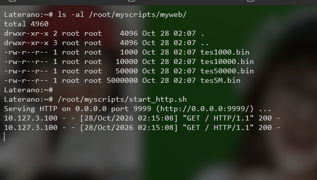 <br />
  <p>Laterano membuat file bin dan run server http</p> <br />
  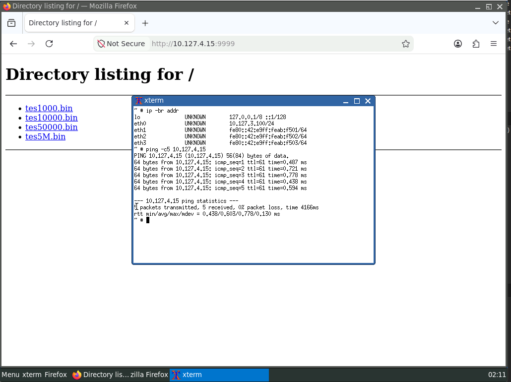 <br />
  <p>Test laterano http server lewat Columbia</p><br />
</div>

#### Soal A.3.6 - Verifikasi Awal dari Columbia

> Dari Columbia (VNC/xterm), tunjukkan lease DHCP dari Victoria, `ping` ke `[IP Prefix].4.15`, dan Firefox ke `http://[IP Prefix].4.15:9999` yang menampilkan seluruh berkas uji pada listing.
>
> _From Columbia (VNC/xterm), show the DHCP lease from Victoria, `ping` to `[IP Prefix].4.15`, and Firefox at `http://[IP Prefix].4.15:9999` listing all the test files._

**Answer:**

<div align="center">
   <br />
  <p>Laterano membuat file bin dan run server http</p> <br />
</div>

## Problem A.4 - Three-Way Handshake

> [!NOTE]
> Skenario 1: tanpa gangguan `tc/netem` pada eth1 dan eth2 RhodesIsland. Download `tes10000.bin` dari Columbia ke Laterano (port 9999). Capture Wireshark di **Columbia** dan **Laterano** dengan filter `tcp.port == 9999`.
>
> _Scenario 1: no `tc/netem` disruption on eth1 and eth2 of RhodesIsland. Download `tes10000.bin` from Columbia to Laterano (port 9999). Capture with Wireshark on **Columbia** and **Laterano** using the filter `tcp.port == 9999`._

#### Soal A.4.1 - Persiapan & Prediksi

> Pastikan tidak ada qdisc gangguan (`tc qdisc show`/`tc qdisc del`). Tuliskan **prediksi** ISN client pada paket SYN sebelum melihat capture.
>
> _Make sure no disruptive qdisc is active. Write your **prediction** of the client's ISN in the SYN packet before looking at the capture._

**Answer:**

```
Prediksi saya: sequence number packet SYN akan dimulai dari 0

put screenshot of tc qdisc show eth1 / eth2 here
```

<div align="center">
   <br />
  <p>Tidak ada rule pada RhodesIsland eth1 dan eth2</p> <br />
</div>

#### Soal A.4.2 - Tabel Observasi Three-Way Handshake

> [!NOTE]
> Untuk parameter 6-8 gunakan capture **Laterano**; untuk 9-10 gunakan capture **Columbia**.
>
> _For items 6-8, use the **Laterano** capture; for 9-10, use the **Columbia** capture._

> Isi tabel berikut berdasarkan capture Wireshark.
>
> _Fill in the following table based on the Wireshark capture._

| No  | Parameter/Aspek                                                                                                | Field Wireshark                  | Instruksi / _Instruction_                                                                                                                                                                                                                                                                                                                                                | Jawaban & Screenshot                                                                                                                                                                                                                                                                                                                                                                                                                                                                                                                                                  |
| --- | -------------------------------------------------------------------------------------------------------------- | -------------------------------- | ------------------------------------------------------------------------------------------------------------------------------------------------------------------------------------------------------------------------------------------------------------------------------------------------------------------------------------------------------------------------ | --------------------------------------------------------------------------------------------------------------------------------------------------------------------------------------------------------------------------------------------------------------------------------------------------------------------------------------------------------------------------------------------------------------------------------------------------------------------------------------------------------------------------------------------------------------------- |
| 1   | IP sumber dan tujuan<br>_Source and destination IP_                                                            | `ip.src`, `ip.dst`               | Pastikan koneksi terjadi antara client (pengirim request) dan server (penerima request).<br>_Make sure the connection is between the client (request sender) and the server (request receiver)._                                                                                                                                                                         | 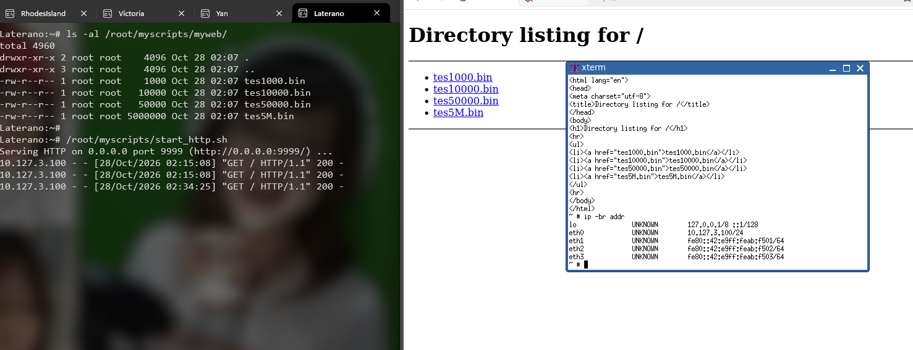 Koneksi client adalah Columbia (10.127.3.100/24) dengan server adalah Laterano (10.127.4.15/24)                                                                                                                                                                                                                                                                                                                                                                                                                               |
| 2   | Proses handshake (3 paket awal)<br>_Handshake process (first 3 packets)_                                       | `tcp.flags.syn`, `tcp.flags.ack` | Amati tiga paket pertama: SYN → SYN-ACK → ACK.<br>_Observe the first three packets: SYN → SYN-ACK → ACK._                                                                                                                                                                                                                                                                | 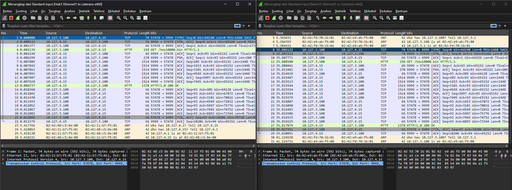                                                                                                                                                                                                                                                                                                                                                                                                                                                                                                                      |
| 3   | Prediksi vs aktual: sequence number awal client<br>_Predicted vs actual: client's initial sequence number_     | `tcp.seq` (SYN)                  | Bandingkan prediksi sebelum capture dengan nilai aktual, jelaskan mengapa ISN acak, bukan nol.<br>_Compare your prediction before the capture with the actual value, and explain why the ISN is random, not zero._                                                                                                                                                       | 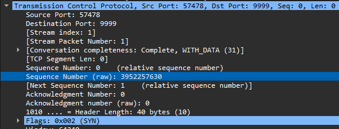 Sequence number secara mentah adalah nilai acak. Nilai 0 merupakan relative sequence dan bukan sequence number asli. Pengacakan nomor ini bertujuan untuk keamanan data agar tidak mudah diretas. Jika nilai awal selalu 0 maka peretas dapat dengan mudah mensetting ISN ke 0 dengan ip palsu dan akan dianggap koneksi valid. Selain itu nilai acak juga mencegah duplicate SYN-ACK. Jika semua packet mulai dari SYN bisa saja paket yang datang bukanlah paket yang benar dan malah dianggap koneksi valid |
| 4   | Sequence number awal server<br>_Server's initial sequence number_                                              | `tcp.seq` (SYN-ACK)              | Tunjukkan byte awal dari sisi server.<br>_Show the initial byte on the server side._                                                                                                                                                                                                                                                                                     |                                                                                                                                                                                                                                                                                                                                                                                                                                                                                                           |
| 5   | ACK setelah handshake<br>_ACK after the handshake_                                                             | `tcp.ack`                        | Tunjukkan bahwa client mengonfirmasi SYN-ACK dari server.<br>_Show that the client acknowledges the server's SYN-ACK._                                                                                                                                                                                                                                                   | 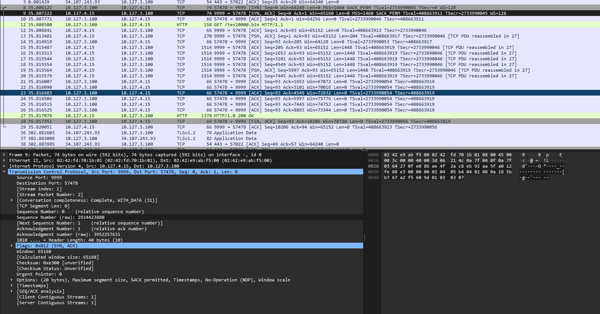                                                                                                                                                                                                                                                                                                                                                                                                                                                                                                 |
| 6   | Verifikasi SEQ segmen berikutnya = SEQ + panjang payload<br>_Verify next segment's SEQ = SEQ + payload length_ | `tcp.seq`, `tcp.len`             | Pilih satu segmen data di tengah stream (bukan segmen pertama atau terakhir), lalu buktikan secara manual bahwa segmen berikutnya memiliki `tcp.seq` = `tcp.seq` + `tcp.len` segmen ini.<br>_Choose a data segment in the middle of the stream (not the first or last), then manually prove that the next segment has `tcp.seq` = this segment's `tcp.seq` + `tcp.len`._ | `tcp.seq` segmen ini: 4549<br>`tcp.len` segmen ini: 1448<br>`tcp.seq` berikutnya: 5997<br>Perhitungan: 4549 + 1448 = 5997<br>                                                                                                                                                                                                                                                                                                                                                                                           |
| 7   | Pola ACK penerima<br>_Receiver's ACK pattern_                                                                  | `tcp.ack`                        | Tunjukkan bahwa ACK bertambah kumulatif, menandakan data diterima secara berurutan.<br>_Show that ACKs increase cumulatively, indicating that data is received in order._                                                                                                                                                                                                | 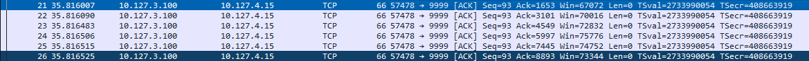                                                                                                                                                                                                                                                                                                                                                                                                                                                                                                                |
| 8   | RTT rata-rata dan implikasinya terhadap timer<br>_Average RTT and its effect on the timer_                     | `tcp.analysis.ack_rtt`           | Catat RTT pada salah satu ACK (di Laterano), lalu diskusikan mengapa timer yang terlalu pendek maupun terlalu panjang sama-sama bermasalah bagi kinerja transfer.<br>_Record the RTT from one ACK (on Laterano), then discuss why a timer that is too short and one that is too long both cause transfer performance problems._                                          | 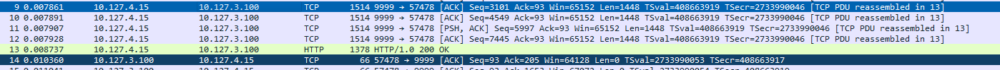 Terdapat selisih yang kecil dan besar pada gambar. Selisih yang kecil menandakan koneksi sangat baik dan traffic sepi. Sedangkan selisih yang besar menandakan koneksi yang melambat dan kemungkinan besar karena traffic yang padat atau terdapat komputasi yang menyebabkan delay                                                                                                                                                                                                                                    |
| 9   | Status retransmisi<br>_Retransmission status_                                                                  | `tcp.analysis.retransmission`    | Semestinya tidak ada retransmisi, menandakan link sehat.<br>_There should be no retransmissions, indicating a healthy link._                                                                                                                                                                                                                                             | 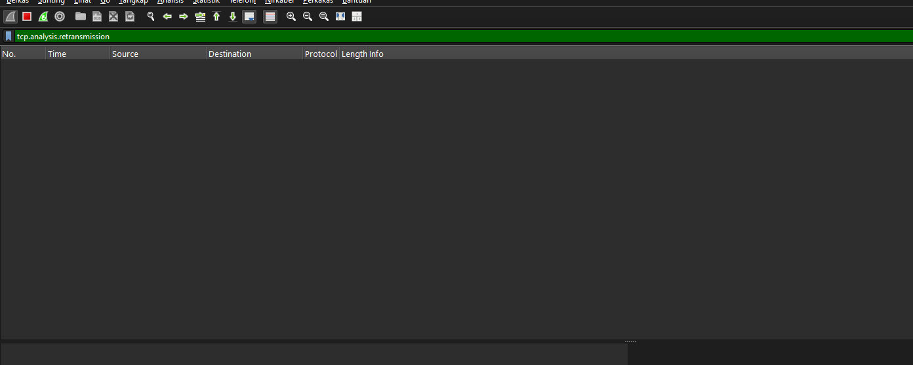                                                                                                                                                                                                                                                                                                                                                                                                                                                                                                              |
| 10  | Pola penutupan koneksi<br>_Connection closing pattern_                                                         | `tcp.flags.fin`, `tcp.flags.ack` | Tunjukkan bahwa TCP menutup koneksi melalui four-way handshake (FIN/ACK).<br>_Show that TCP closes the connection through a four-way handshake (FIN/ACK)._                                                                                                                                                                                                               | 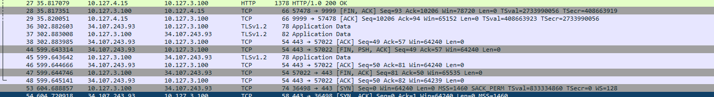                                                                                                                                                                                                                                                                                                                                                                                                                                                                                                                                  |

#### A.4.2 - Pertanyaan Analisis / Refleksi

> 1. Apa fungsi utama sequence number dan acknowledgment number dalam TCP?
>    _What are the main functions of sequence numbers and acknowledgment numbers in TCP?_
> 2. Mengapa ACK pada TCP bersifat kumulatif, bukan per-paket?
>    _Why are TCP ACKs cumulative rather than per-packet?_
> 3. Apa yang akan terjadi jika salah satu segmen data hilang di tengah pengiriman?
>    _What will happen if a data segment is lost in the middle of a transfer?_
> 4. Apa bukti dari hasil Wireshark bahwa TCP berhasil melakukan transfer data secara reliable?
>    _What evidence in the Wireshark results shows that TCP successfully transfers data reliably?_

**Answer:**

1. Sequence number digunakan untuk menjadi identifier pada segmen data yang sedang ditransmisikan. Sedangkan ack number didapat dari relative value sequence number mentah sebagai penanda dan informasi sequence number data yang diterima dan yang diminta. Ini sangat berguna untuk menjamin data ditransmisikan secara reliable atau urut.
2. Jika ack dikirim per packet maka sistem akan mengirim begitu banyak ack. ack tcp tanpa data memiliki ukuran puluhan byte dan jika sistem dirancang mengirim per packet kecil, maka bandwidth bisa penuh hanya dengan ack tcp. Kelebihan lainnya dari cumulative ack adalah memungkinkan congestion control berbasis ukuran byte menyesuaikan optimum speed dari bandwidth yang ada.
3. Pada TCP, receiver bersifat reaktif. Jika dia menerima paket baru dengan sequence number `a` maka dia akan kirim ack `a+1`. Jika ada packet loss misal pada sequence number `b` karena receiver menerima packet `c` (`c` > `b`) maka dia akan kirim ack `b+1`, jika masih belum menerima packet dengan sequence number `b` maka dia tetap kirim ack `b+1` sampai packet `b` sampai. Apabila ack ternyata ikut loss maka akan terjadi timeout pada sender dan otomatis akan mengirim ulang packet loss tersebut sampai ia menerima ack >= `b+1`. Jika ack berhasil diterima oleh sender maka sender mendeteksi duplicate ack dan menghitungnya sampai 3 duplicate ack. Setelah mencapai 3, sender akan kirim ulang segmen data ack tersebut.
4. Transfer data reliable dicapai karena berhasil memastikan mengirim semua data dibuktikan dengan tracking data lewat sequence number dan ack memastikan tiap data sudah dikirim dengan benar dan bisa diurutkan.

---

# Bagian B - Retransmission & Duplicate ACK

> [!NOTE]
> Skenario 2: packet loss 1% pada eth1 dan eth2 RhodesIsland. Download `tes5M.bin`. Untuk parameter 2 dan 5 gunakan capture **Columbia**; selain itu gunakan capture **Laterano**.
>
> _Scenario 2: 1% packet loss on eth1 and eth2 of RhodesIsland. Download `tes5M.bin`. For items 2 and 5, use the **Columbia** capture; for the others, use the **Laterano** capture._

## Problem B.1 - B.3

#### Soal B.1 - Persiapan Gangguan & Prediksi

> Terapkan `tc qdisc add dev eth1/eth2 root netem loss 1%`. Tuliskan prediksi reaksi penerima terhadap loss sebelum melihat capture.
>
> _Apply `tc qdisc add dev eth1/eth2 root netem loss 1%`. Write your prediction of the receiver's reaction to loss before looking at the capture._

**Answer:**

```
Prediksi saya: Receiver akan mendeteksi packet tidak datang secara urut dan ada yang mendahului packet lain dan akan mengirim ack duplicate. Akan terjadi packet loss sekitar 1-2% dan bisa fluktuatif. Cara melihatnya dengan melihat ada berapa duplicate ack yang muncul, seharusnya di kisaran 2 kali loss %. Juga melihat berapa data yang diretransmisi seahrusnya di sekitar loss %

put screenshot of tc qdisc show eth1 / eth2 here
```

<div align="center">
  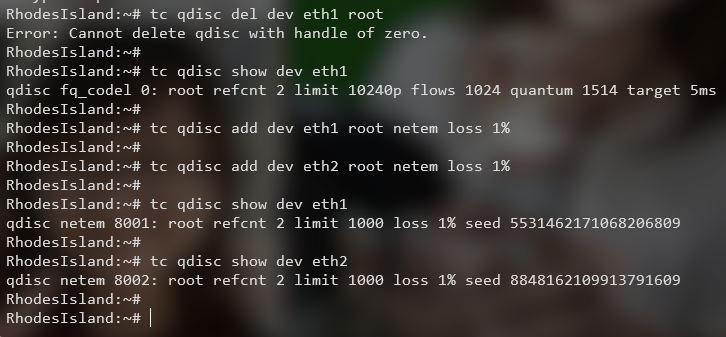 <br />
  <p>Traffic control di RhodesIsland</p> <br />
</div>

#### Soal B.3 - Tabel Observasi Retransmisi & Duplicate ACK

> Isi tabel berikut berdasarkan capture Wireshark dan output `curl`.
>
> _Fill in the following table based on the Wireshark capture and the `curl` output._

| No  | Parameter/Aspek                                                                                                                       | Field Wireshark                                           | Instruksi / _Instruction_                                                                                                                                                                                                                                                                                      | Jawaban & Screenshot                                                                                                                                                                                                                                                                                                                                                                                                                                                                                                                                                                                                                                                                                                                                                                                                                                                                    |
| --- | ------------------------------------------------------------------------------------------------------------------------------------- | --------------------------------------------------------- | -------------------------------------------------------------------------------------------------------------------------------------------------------------------------------------------------------------------------------------------------------------------------------------------------------------- | --------------------------------------------------------------------------------------------------------------------------------------------------------------------------------------------------------------------------------------------------------------------------------------------------------------------------------------------------------------------------------------------------------------------------------------------------------------------------------------------------------------------------------------------------------------------------------------------------------------------------------------------------------------------------------------------------------------------------------------------------------------------------------------------------------------------------------------------------------------------------------------- |
| 1   | Persentase loss yang disimulasikan<br>_Simulated loss percentage_                                                                     | `tc qdisc show`                                           | Tunjukkan nilai setup packet loss (1%) pada `tc netem`.<br>_Show the packet loss setting (1%) in `tc netem`._                                                                                                                                                                                                  |  Terlihat RhodesIsland sudah memiliki loss 1% pada kedua ether                                                                                                                                                                                                                                                                                                                                                                                                                                                                                                                                                                                                                                                                                                                                                                     |
| 2   | Prediksi vs aktual: reaksi penerima terhadap loss (Columbia)<br>_Predicted vs actual: receiver's response to loss (Columbia)_         | `tcp.analysis.duplicate_ack`                              | Bandingkan prediksi dengan pola dupACK aktual (ACK bernomor sama berulang), bukan NAK.<br>_Compare your prediction with the actual dupACK pattern (repeated ACKs with the same number), not NAK._                                                                                                              | 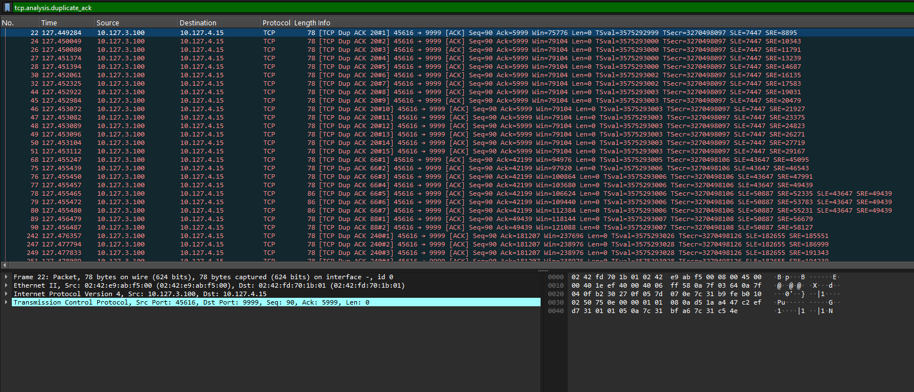 Sesuai prediksi, receiver mengirim duplicate ack dan di wireshark ditampilkan sekitar 2.8% data packet, sesuai di kisaran netem loss %                                                                                                                                                                                                                                                                                                                                                                                                                                                                                                                                                                                                                                                                                                               |
| 3   | Jumlah retransmisi<br>_Number of retransmissions_                                                                                     | `tcp.analysis.retransmission`                             | Tunjukkan paket yang dikirim ulang akibat tidak menerima ACK yang diharapkan.<br>_Show the packets sent again because the expected ACK was not received._                                                                                                                                                      | 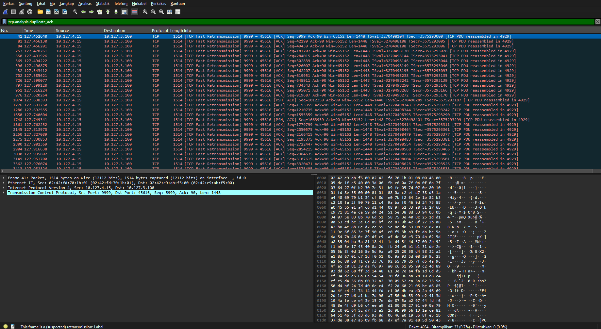 Di bagian bawah ditampilkan 33 dari 4934 yang berarti ada 0.7% packet loss                                                                                                                                                                                                                                                                                                                                                                                                                                                                                                                                                                                                                                                                                                                                                   |
| 4   | Verifikasi SEQ segmen retransmisi = SEQ segmen asli yang hilang<br>_Verify retransmitted segment's SEQ = original lost segment's SEQ_ | `tcp.seq`, `tcp.len`                                      | Bandingkan paket `tcp.analysis.retransmission` dengan segmen aslinya, buktikan bahwa retransmisi mengirim ulang byte yang identik, bukan data baru.<br>_Compare a `tcp.analysis.retransmission` packet with its original segment, and prove that the retransmission sends the same bytes again, not new data._ | Segmen asli: seq = 4551, len = 1448<br>Retransmisi: seq = 5999, len = 1448<br> 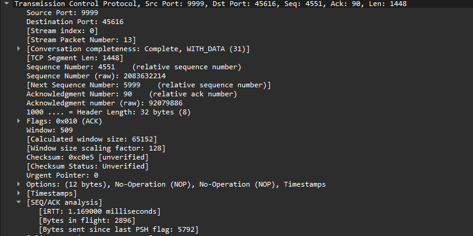 <br> Segment sebelumnya memiliki next seq 5999 <br> 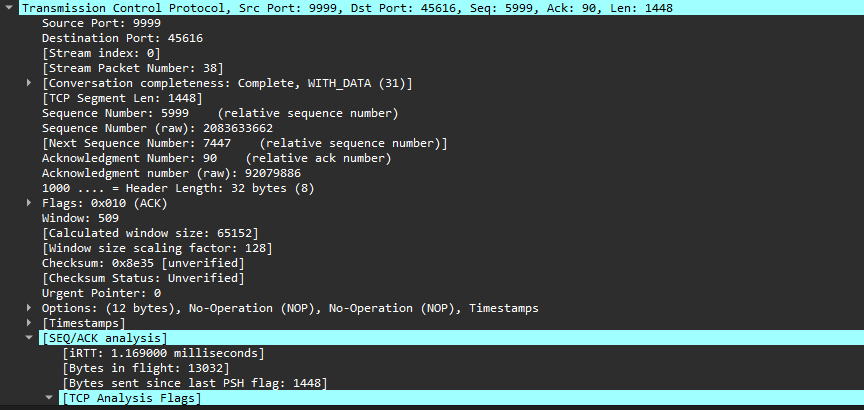 <br> server kirim ulang 5999                                                                                                                                                                                                                                                                                                                                                                                                                                                                                                                                                                                                                             |
| 5   | Jumlah duplicate ACK (Columbia)<br>_Number of duplicate ACKs (Columbia)_                                                              | `tcp.analysis.duplicate_ack`                              | Tunjukkan bahwa sedikitnya 3 dupACK berturut-turut memicu fast retransmit.<br>_Show that at least 3 consecutive dupACKs trigger fast retransmit._                                                                                                                                                              |  <br> Dapat dilihat di sini `seq=49349` mengalami 2 kali dupack dan bisa dilihat juga <br> 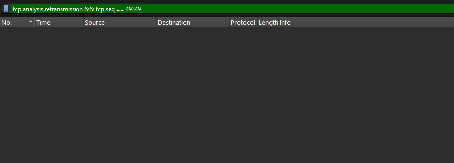 <br> `seq=49349` tidak mengalami retransmit. Ini membuktikan setidaknya 3 dup ack agar terjadi retransmit                                                                                                                                                                                                                                                                                                                                                                                                                                                                                                                                                                               |
| 6   | RTT sebelum dan sesudah loss<br>_RTT before and after loss_                                                                           | `tcp.analysis.ack_rtt`                                    | Tunjukkan bahwa RTT cenderung meningkat karena waktu recovery.<br>_Show that RTT tends to increase because of recovery time._                                                                                                                                                                                  | 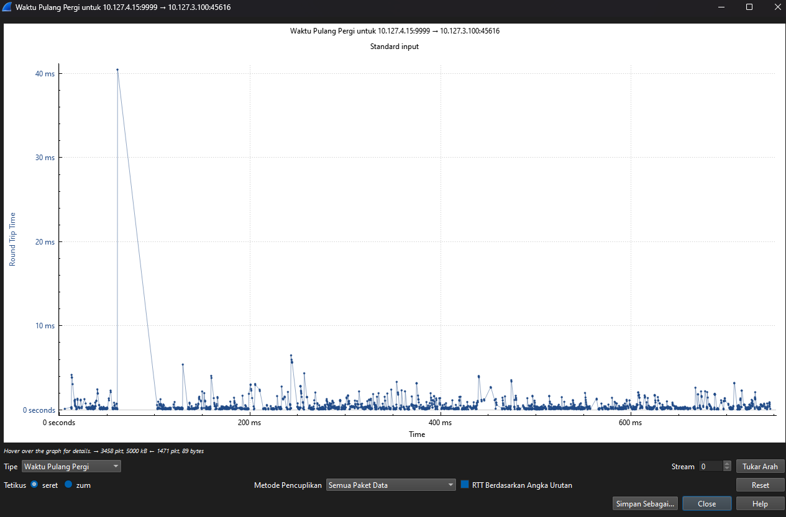 <br> Dapat dilihat grafik rtt loss lebih tinggi daripada rtt no loss di bawah <br> <br> 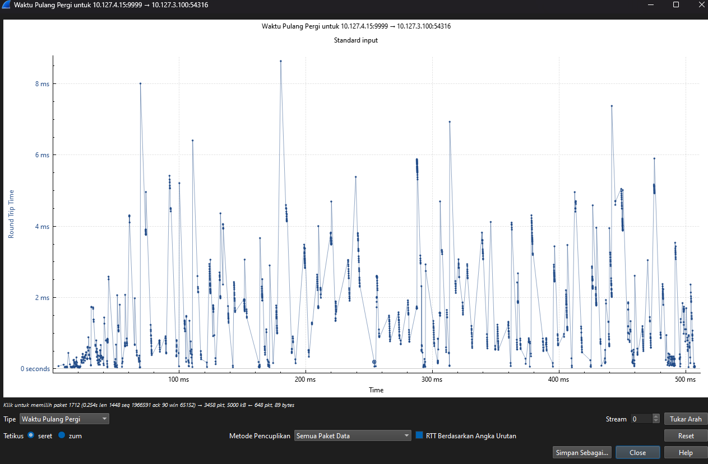 <br> Hanya sekian ms pada no loss dan puluhan ms pada 1% loss                                                                                                                                                                                                                                                                                                                                                                                                                                                                                                                                                                                                                                                   |
| 7   | Fast retransmit terdeteksi beserta selisih waktunya<br>_Detected fast retransmit and its time difference_                             | `tcp.analysis.fast_retransmission`, `frame.time_relative` | Ukur selisih waktu antara dupACK ke-3 dan retransmisi yang menyusul, bandingkan dengan potensi timeout.<br>_Measure the time between the third dupACK and the retransmission that follows, and compare it with a possible timeout._                                                                            | Ambil salah satu sample RTT berikut <br> 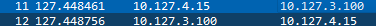 <br> Maka bisa dihitung $\text{SRTT} = RTT_{sample} = 0.000295$ detik$\text{RTTVAR} = \frac{RTT_{sample}}{2} = 0.0001475$ detik dan didapat timeoutnya:<br> $$\text{RTO} = \text{SRTT} + (4 \times \text{RTTVAR})$$$$\text{RTO} = 0.000295 + (4 \times 0.0001475)$$$$\text{RTO} = 0.000295 + 0.000590$$$$\text{RTO} = \mathbf{0.000885 \text{ detik}}$$. Ini masih sangat jauh dari selisih waktu retransmit dan dupack ketiga berikut: <br>  <br> 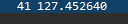 <br> Jika gambar tidak muncul (dimensi terlalu kecil/besar) bisa dicek di filenya langsung di sini: <br> [time-dupack#3](./docs/B.3/time-dupack#3.png) <br> [time-retransmit-dupack#3](./docs/B.3/time-retransmit-dupack#3.png) |
| 8   | Timeout retransmission<br>_Timeout retransmission_                                                                                    | `frame.time_relative`                                     | Terjadi bila tidak ada dupACK yang memicu fast retransmit. Jika tidak muncul, jelaskan apa yang diamati beserta alasannya.<br>_Occurs when there are no dupACKs to trigger fast retransmit. If it does not appear, describe what was observed and why._                                                        | 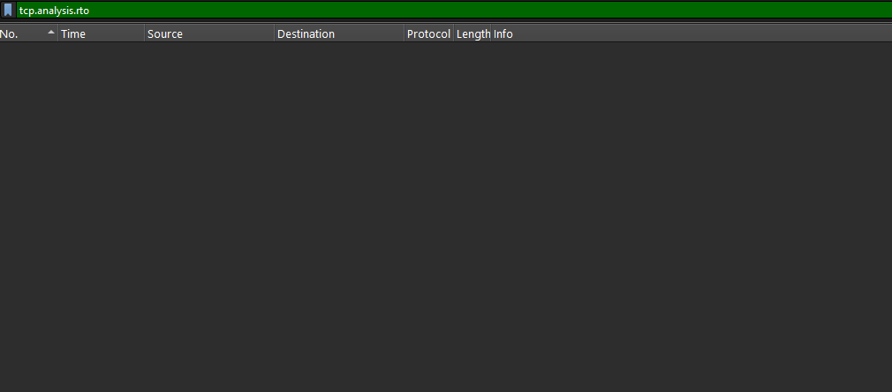 <br> Bisa dilihat tidak ada timeout retransmission yang terjadi. Ini karena di RhodesIsland kita hanya simulasi loss 1% yang mana sangat kecil kemungkinan terjadi timeout.                                                                                                                                                                                                                                                                                                                                                                                                                                                                                                                                                                                                                                                        |
| 9   | Throughput rata-rata<br>_Average throughput_                                                                                          | `curl -w` (`speed_download`)                              | Bandingkan dengan throughput pada Skenario 1 (tanpa loss).<br>_Compare with the throughput in Scenario 1 (without loss)._                                                                                                                                                                                      | 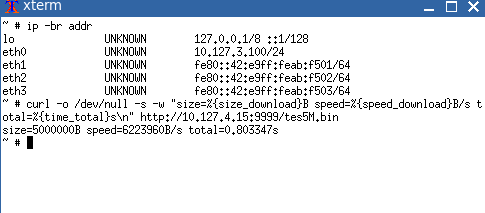 <br> Speed dengan loss 6.224 MB/s <br>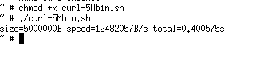<br> Hampir dua kali lipatnya                                                                                                                                                                                                                                                                                                                                                                                                                                                                                                                                                                                                                                                                                                       |
| 10  | Lama transfer total<br>_Total transfer duration_                                                                                      | `curl -w` (`time_total`)                                  | Tunjukkan bahwa waktu transfer meningkat dibanding Skenario 1.<br>_Show that the transfer time increases compared with Scenario 1._                                                                                                                                                                            |  <br> Waktunya 0.8s <br> <br> Waktunya 0.4s, setengahnya                                                                                                                                                                                                                                                                                                                                                                                                                                                                                                                                                                                                                                                                                                                           |
| 11  | Pola congestion window (perkiraan)<br>_Congestion window pattern (estimate)_                                                          | `tcp.analysis.bytes_in_flight`                            | Tunjukkan bahwa cwnd menurun setelah loss, indikasi congestion control aktif.<br>_Show that cwnd decreases after loss, indicating that congestion control is active._                                                                                                                                          | 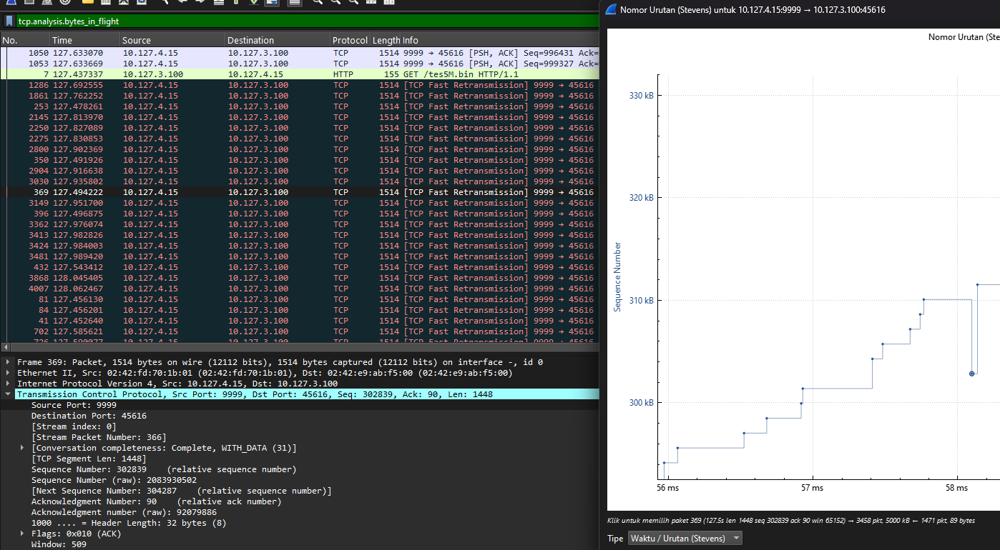 <br> Bisa dilihat pada grafik stevens time sequence menunjukkan drop saat melakukan retransmission mengkonfirmasi indikasi congestion control aktif (stevens graph digunakan untuk melihat congestion control pada traffic dan juga memberikan gambaran pada cwnd di sisi sender sekaligus sesuai soal)                                                                                                                                                                                                                                                                                                                                                                                                                                                                                                                                          |

#### B.3 - Pertanyaan Analisis / Refleksi

> 1. Bagaimana TCP mengetahui bahwa sebuah segmen hilang?
>    _How does TCP know that a segment is lost?_
> 2. Jelaskan perbedaan antara timeout retransmission dan fast retransmit.
>    _Explain the difference between timeout retransmission and fast retransmit._
> 3. Mengapa throughput menurun saat terjadi packet loss?
>    _Why does throughput decrease when packet loss occurs?_
> 4. Bagaimana Wireshark menunjukkan bahwa TCP tetap reliable meskipun terjadi packet loss?
>    _How does Wireshark show that TCP remains reliable even when packet loss occurs?_

**Answer:**

1. Segmen hilang bisa diketahui setelah sender menerima 3 duplicate ack dari receiver atau sender tidak menerima ack sampai batas waktu rto seperti di tabel. Sistem ini didesain agar receiver mengirim ack segmen data next yang dibutuhkan saat menerima data. Apabila terjadi data yg datang tidak urut, receiver tahu pasti ada packet loss di tengah2 sehingga mengirimkan duplicate ack yang sebelumnya dan begitu seterusnya. Apabila tidak ada data yang datang di receiver maka receiver tetap diam dan sender menyadari tidak ada ack sampai batas waktu rto maka sender tahu packet loss.
2. Timeout retransmit terjadi jika packet loss terjadi jika tidak ada ack dari receiver sampai batas waktu retransmit time out (rto). Sedangkan fast retransmit terjadi saat sender menerima >= 3 dup ack dari receiver (juga mengindikasi adanya unordered packet arrival di receiver).
3. Karena throughput linear terhadap packet karena dihitung dari ukuran packet (B/s). Jika ada packet loss (turun) maka throughput juga pasti turun.
4. Wireshark menunjukkan adanya retransmit pada semua packet loss yang tercatat. Ini menunjukkan sistem tcp sangat reliable.

---

# Bagian C - TCP Congestion Control (CUBIC vs Reno)

> [!NOTE]
> Skenario 3: loss 1%, delay 100 ms, rate limit 2 Mbps (tbf + netem) pada eth1 dan eth2 RhodesIsland. Algoritma diatur di **Laterano** (sender). Download `tes5M.bin`. Untuk parameter 4, 5, dan 9 gunakan capture **Columbia**; selain itu gunakan capture **Laterano**. Jangan klaim mengukur cwnd secara langsung dari grafik Time-Sequence / `bytes_in_flight`.
>
> _Scenario 3: 1% loss, 100 ms delay, 2 Mbps rate limit (tbf + netem) on eth1 and eth2 of RhodesIsland. The algorithm is set on **Laterano** (sender). Download `tes5M.bin`. For items 4, 5, and 9 use the **Columbia** capture; for the others use the **Laterano** capture. Do not claim to measure cwnd directly from the Time-Sequence graph / `bytes_in_flight`._

## Problem C.1 - C.3

#### Soal C.1 - Setup Gangguan & Prediksi Kurva cwnd

> Tunjukkan konfigurasi `tc` (tbf + netem). Tuliskan prediksi bentuk kurva cwnd untuk Reno dan CUBIC sebelum melihat grafik.
>
> _Show the `tc` configuration (tbf + netem). Write your predicted cwnd curve shape for Reno and CUBIC before looking at the actual graphs._

**Answer:**

```
Prediksi Reno  : Dari gambar yang saya pelajari di internet, reno menaikkan cwnd secara additive (linear) dan drop setengah saat bottleneck. Lalu mengulangi apa yang terjadi sebelumnya
Prediksi CUBIC : Dari gambar yang saya pelajari di internet, CUBIC menaikkan cwnd secara eksponensial (non-linear) lalu agak pelan setelah melewati ssthresh dan drop sedikit saat bottleneck. Lalu akan mengulangi apa yang terjadi sebelumnya

put screenshot of tc qdisc show eth1 / eth2 here
```

<div align="center">
  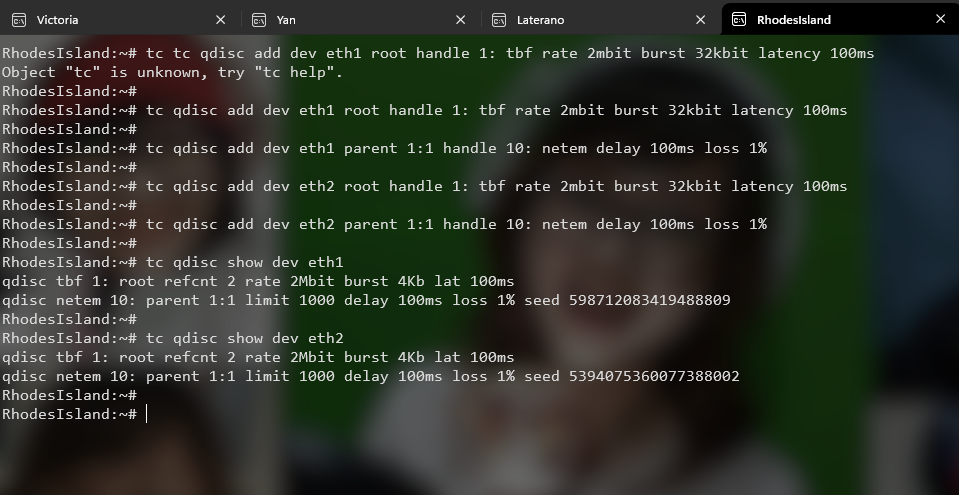 <br />
  <p>Traffic control di RhodesIsland</p> <br />
</div>

#### Soal C.2 - Konfigurasi Algoritma Congestion Control

> Atur algoritma di Laterano (sender) lalu jalankan download `tes5M.bin` dari Columbia untuk masing-masing algoritma.
>
> _Set the algorithm on Laterano (sender), then download `tes5M.bin` from Columbia for each algorithm._

| Langkah / _Step_                             | CUBIC                                                                                                                                                                 | Reno                                                                                                                   |
| -------------------------------------------- | --------------------------------------------------------------------------------------------------------------------------------------------------------------------- | ---------------------------------------------------------------------------------------------------------------------- |
| Command di Laterano<br>_Command on Laterano_ | `ip tcp_metrics flush`<br>`sysctl -w net.ipv4.tcp_no_metrics_save=1`<br>`sysctl -w net.ipv4.tcp_congestion_control=cubic`<br>`sysctl net.ipv4.tcp_congestion_control` | `sysctl -w net.ipv4.tcp_congestion_control=reno`<br>`ip tcp_metrics flush`<br>`sysctl net.ipv4.tcp_congestion_control` |
| Command di Columbia<br>_Command on Columbia_ | `curl ... tes5M.bin` (sama seperti Skenario 1 dan 2 / _same as Scenarios 1 and 2_)                                                                                    | `curl ... tes5M.bin` (sama seperti CUBIC / _same as CUBIC_)                                                            |
| Screenshot                                   | 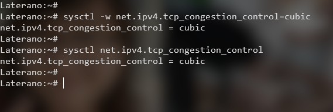 <br> Untuk laterano <br> 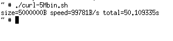 <br> Untuk Columbia                                                          | 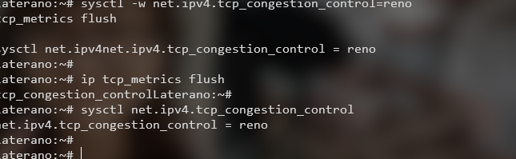 <br> Untuk laterano <br> 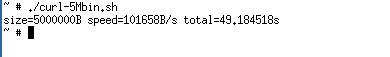 <br> Untuk Columbia                     |

#### Soal C.3 - Tabel Perbandingan CUBIC vs Reno

> Isi tabel berikut dengan hasil aktual untuk CUBIC dan Reno (nilai + screenshot), lalu tulis analisis singkat pada kolom catatan.
> Setiap sel kosong untuk CUBIC dan RENO pada tabel di bawah **wajib** berisi **nilai aktual** dan **screenshot** sebagai bukti, kecuali parameter nomor 1.
>
> _Fill in the following table with actual results for CUBIC and Reno (value + screenshot), then write a short analysis in the notes column._
> _Every cell for CUBIC and RENO column in the table below **must** contain the **actual value** and a **screenshot** as evidence, except for parameter 1._

| No  | Parameter/Aspek                                                                        | Field Wireshark / Command      | CUBIC                                                                                                                                                   | Reno                                                                                                                                                                                                                                        | Catatan analisis / _Analysis notes_                                                                                                                 |
| --- | -------------------------------------------------------------------------------------- | ------------------------------ | ------------------------------------------------------------------------------------------------------------------------------------------------------- | ------------------------------------------------------------------------------------------------------------------------------------------------------------------------------------------------------------------------------------------- | --------------------------------------------------------------------------------------------------------------------------------------------------- |
| 1   | Prediksi vs aktual: bentuk kurva cwnd<br>_Predicted vs actual: cwnd curve shape_       | Time - Sequence Graph          | 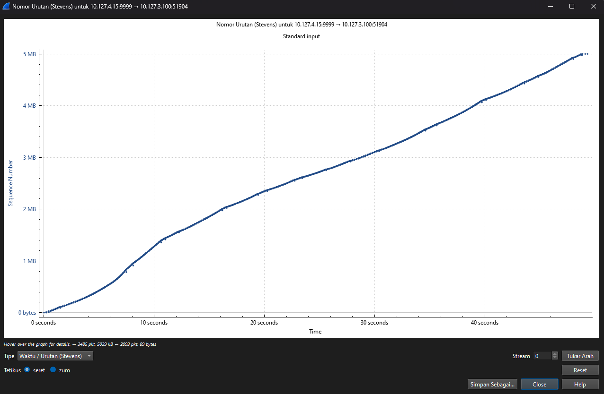 Sesuai dugaan CUBIC naik secara tidak linear                                                                                      | 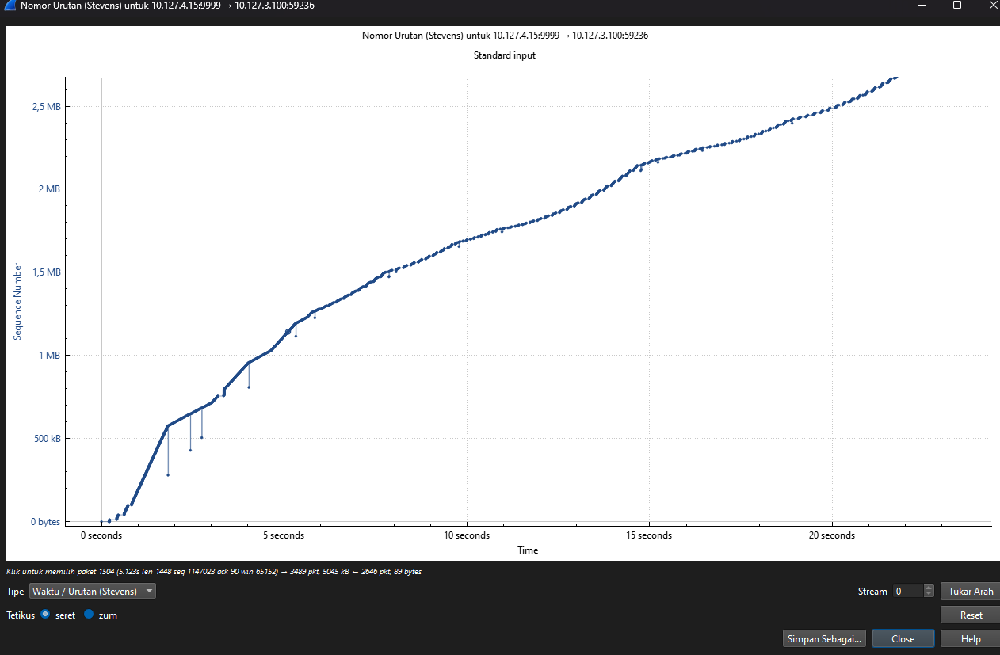 Sesuai dugaan Reno akan naik secara linear                                                                                                                                                                       | Cocokkan dugaan awal dengan kurva aktual; jelaskan bila berbeda.<br>_Match your initial prediction with the actual curve; explain any differences._ |
| 2   | RTT rata-rata (ms)<br>_Average RTT (ms)_                                               | `tcp.analysis.ack_rtt`         |  <br> Setelah saya amati, ack rtt berada di ~200 ms dan cukup stabil. Hanya <10 packet yang memiliki rtt microsecond atau > 300 ms | 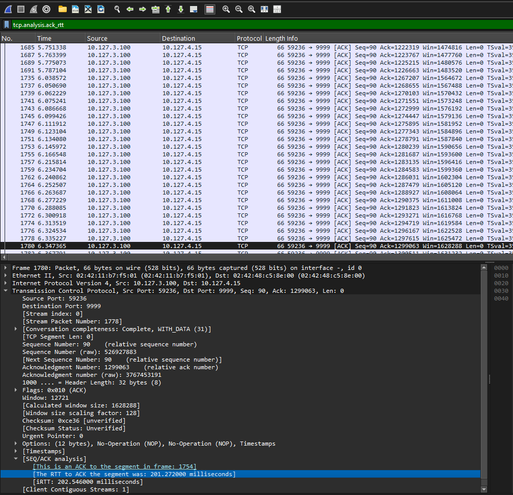 <br> Setelah saya amati, ack rtt tidak konstan. Pada 1000 packet pertama terjadi kenaikan perlahan hingga 1 s lalu perlahan menurun lagi mendekati packet 1700 dan setelah packet 2000 menjadi konstan di 200 ms | RTT stabil menunjukkan congestion control yang efisien.<br>_A stable RTT indicates efficient congestion control._                                   |
| 3   | RTT maksimum (ms)<br>_Maximum RTT (ms)_                                                | `tcp.analysis.ack_rtt`         | 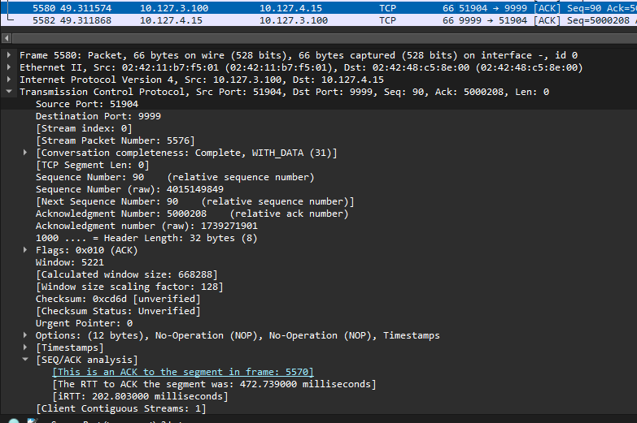 <br> Max RTT yang saya temukan adalah ~470ms                                                                                      | 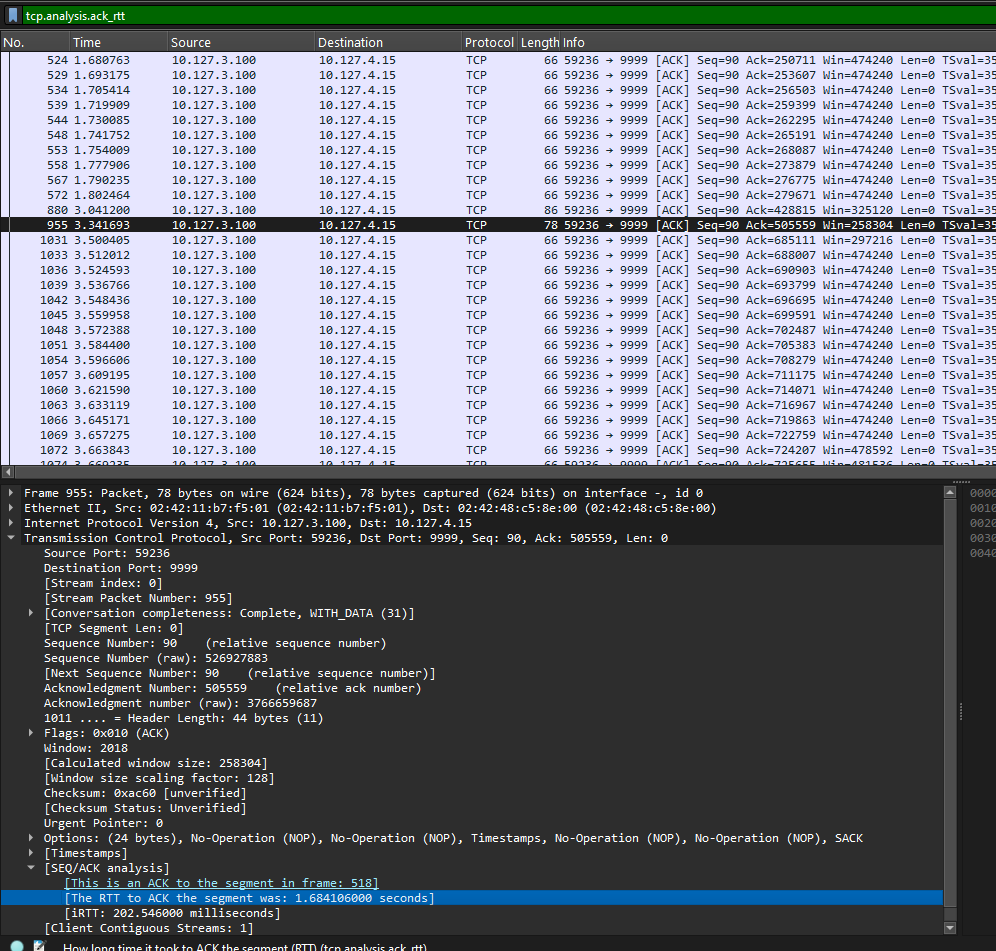 <br> Max RTT yang saya temukan adalah ~1.6s                                                                                                                                                                      | RTT tinggi mengindikasikan queue buildup pada jalur.<br>_A high RTT indicates queue buildup along the path._                                        |
| 4   | Throughput (B/s) (Columbia)<br>_Throughput (B/s) (Columbia)_                           | `curl -w` (`speed_download`)   |  Speednya hanya 99781B/s sangat lambat                                                                                           |  <br> Speed kurang lebih sama di sekitar 10000B/s                                                                                                                                                               |                                                                                                                                                     |
| 5   | Waktu transfer total (s) (Columbia)<br>_Total transfer time (s) (Columbia)_            | `curl -w` (`time_total`)       |  Waktu download sekitar 50s                                                                                                 |                                                                                                                                                                                                                                             |                                                                                                                                                     |
| 6   | Jumlah retransmisi<br>_Number of retransmissions_                                      | `tcp.analysis.retransmission`  | 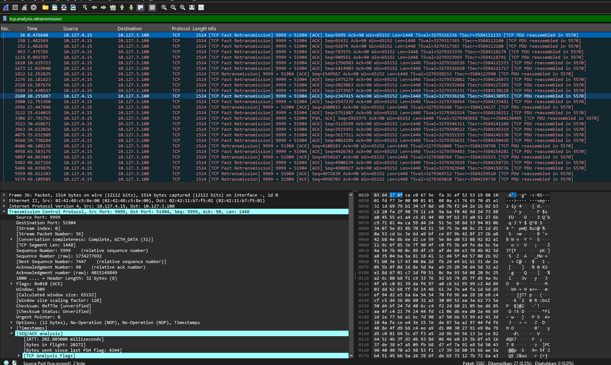 <br> Jumlah retransmisi tercatat ada 27 packet                                                                                    | 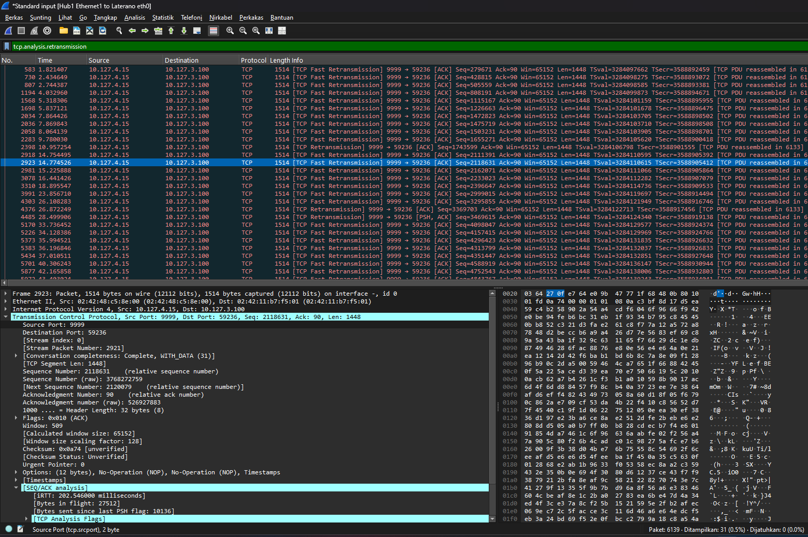 <br> Jumlah retransmisi tercatat ada 31                                                                                                                                                                          | Retransmisi yang banyak mengindikasikan algoritma bersifat loss-based.<br>_Many retransmissions indicate a loss-based algorithm._                   |
| 7   | Jumlah duplicate ACK<br>_Number of duplicate ACKs_                                     | `tcp.analysis.duplicate_ack`   | 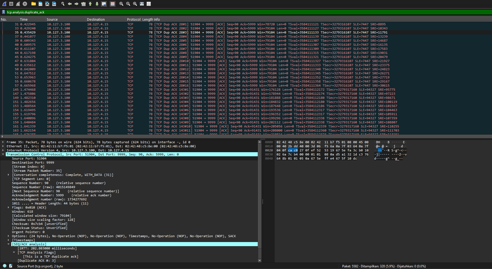 <br> Terdapat 328 packet duplicate ack                                                                                            | 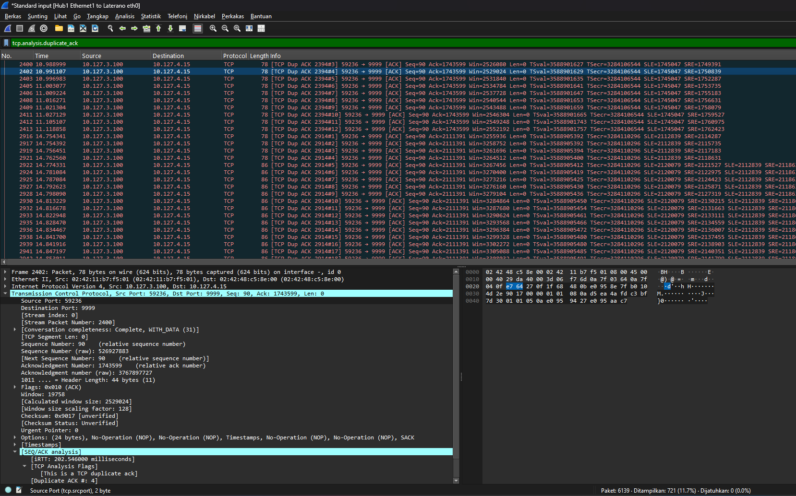 <br> terdapat 721 packet duplicate ack                                                                                                                                                                           | Indikasi segmen yang sempat hilang di tengah transfer.<br>_An indication of segments lost during the transfer._                                     |
| 8   | Pola congestion window (awal - akhir)<br>_Congestion window pattern (start - end)_     | `tcp.analysis.bytes_in_flight` | 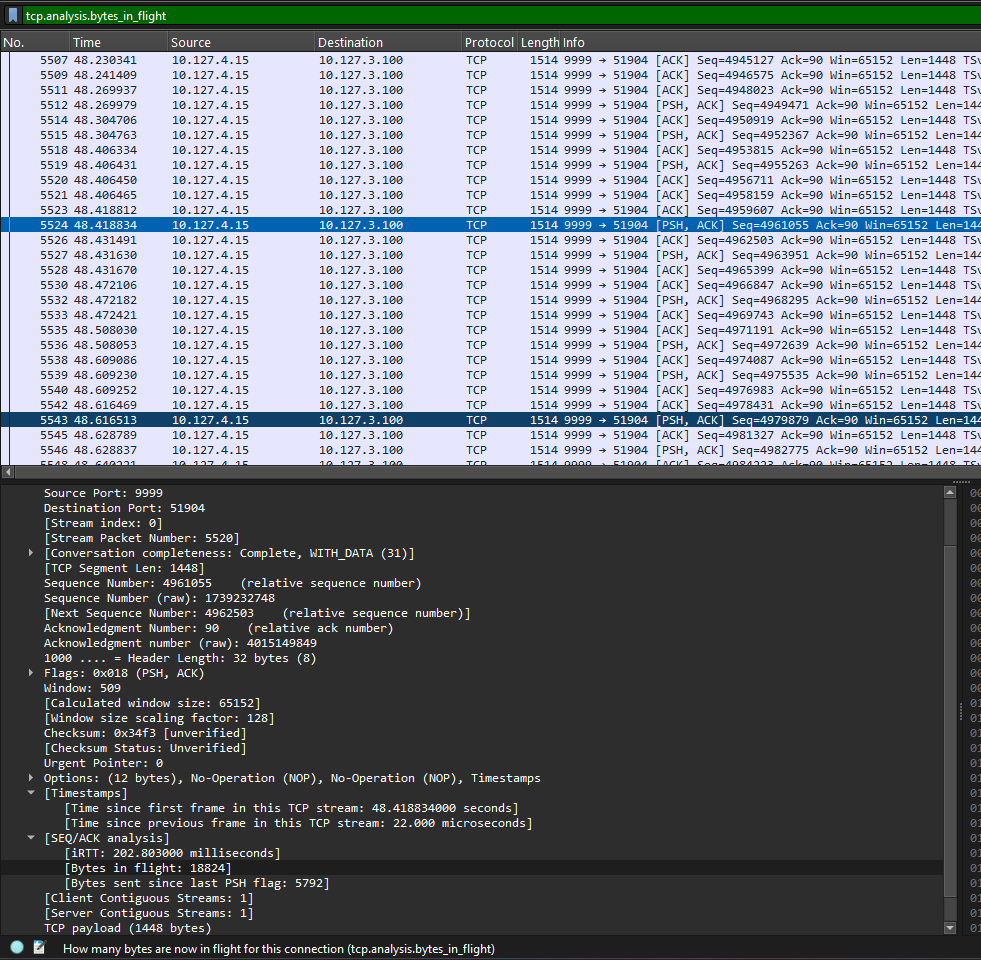 <br> Dari beberapa packet yang saya amati, rata-rata bytes_in_flight adalah ~1800.                                                | 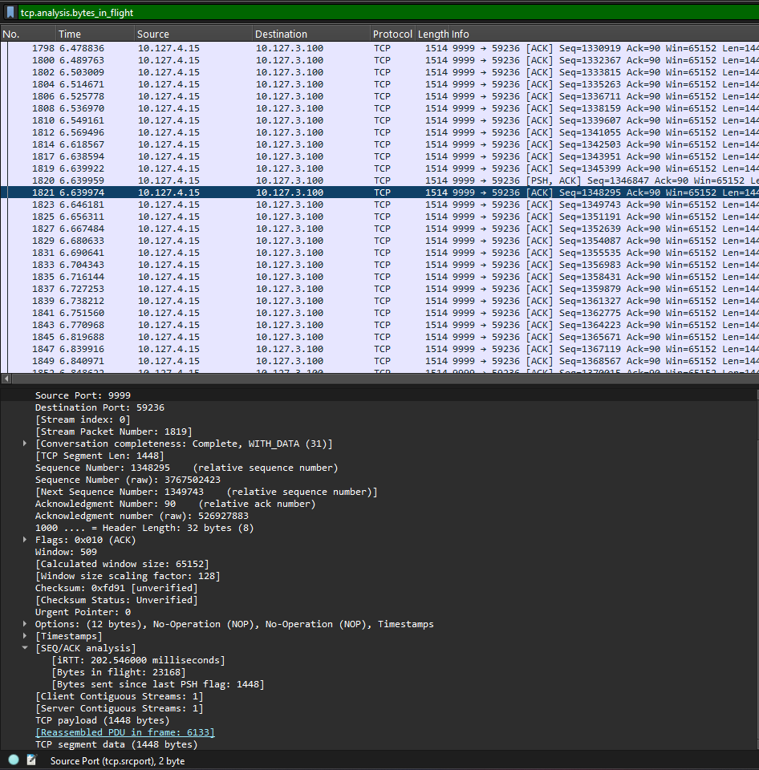 <br> Pola mengikuti grafik nomor 1, dan 2. Pada awal packet ukuran sangat besar menyentuh 70000 lalu turun ke 40000 dan 30000 di packet 1000-1500 dan stabil di packet 2000 di ~20000                            | Amati pertumbuhan dan stabilitas pada grafik Time - Sequence.<br>_Observe growth and stability in the Time - Sequence graph._                       |
| 9   | Nilai receive window rata-rata (Columbia)<br>_Average receive window value (Columbia)_ | `tcp.window_size_value`        | 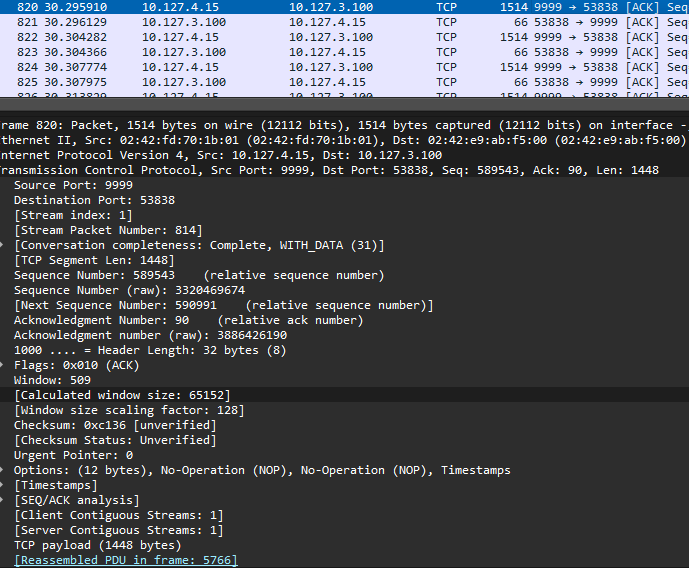 <br> Dari pengamatan beberapa packet, rcvwnd cukup consistent di sekitar 65152 seperti contoh sample di atas                | 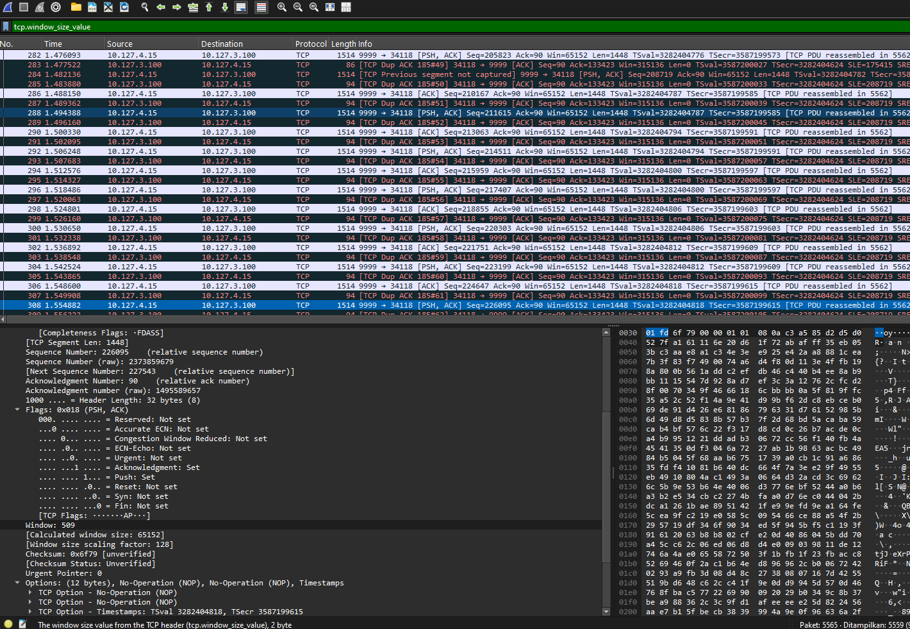 <br> Dari pengamatan, terdapat fluktuatif extreme dari 509 ke ~2000 an terutama pada bagian terjadinya dup ack                                                                                                   | Menunjukkan kapasitas buffer di sisi penerima.<br>_Shows the buffer capacity on the receiver side._                                                 |
| 10  | Stabilitas throughput (grafik)<br>_Throughput stability (graph)_                       | Throughput Graph               | 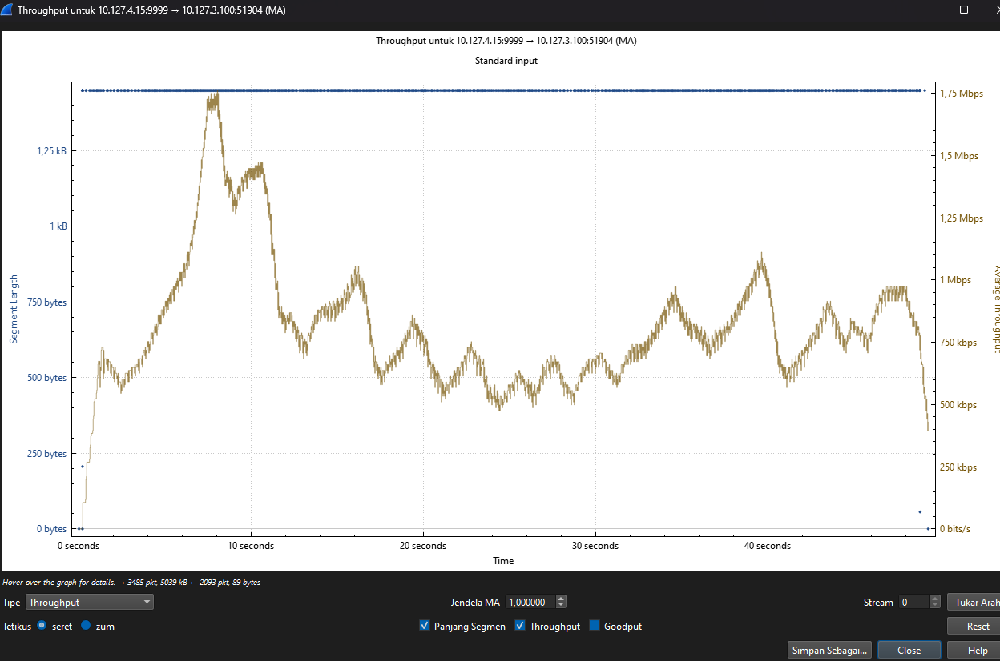 <br> Grafik fluktuatif namun nilai min-max cukup stabil                                                                          | 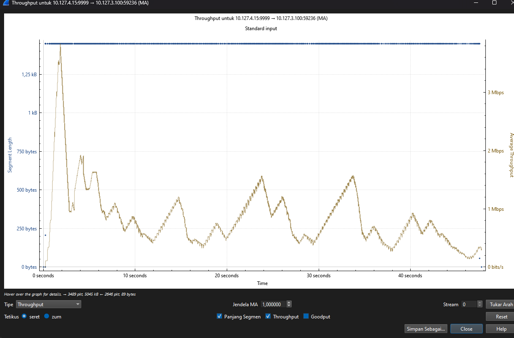 <br> Grafik fluktuatif dan naik cepat dengan min-max yang tidak sekonsisten sebelumnya (CUBIC)                                                                                                                  | Apakah throughput cenderung konstan atau berfluktuasi.<br>_Whether throughput tends to stay constant or fluctuate._                                 |

#### C.3 - Pertanyaan Analisis / Refleksi

> 1. Algoritma mana yang memberikan throughput lebih tinggi pada kondisi jaringan ini? Mengapa demikian?
>    _Which algorithm provides higher throughput under these network conditions? Why?_
> 2. Apakah ada hubungan antara jumlah retransmisi dan jenis algoritma congestion control yang digunakan?
>    _Is there a relationship between the number of retransmissions and the congestion control algorithm used?_
> 3. Apa perbedaan bentuk kurva congestion window antara Reno dan Cubic pada grafik Time-Sequence (Stevens)?
>    _How do the congestion window curves of Reno and Cubic differ in the Time-Sequence (Stevens) graph?_
> 4. Algoritma mana yang paling sensitif terhadap RTT tinggi?
>    _Which algorithm is most sensitive to high RTT?_
> 5. Algoritma mana yang lebih efisien pada jaringan dengan latency tinggi seperti pada skenario ini? Jelaskan.
>    _Which algorithm is more efficient on a network with high latency, as in this scenario? Explain._

**Answer:**

```
1. TCP Cubic jelas memberi throughput lebih tinggi. Menggunakan kenaikan eksponensial menyebabkan kenaikan signifikan pada throughput, berbanding terbalik dengan reno naik secara linear. Walau begitu pada akhirnya secara rata-rata kecepatan download selisih rendah tapi cukup mempercepat proses download sekitar 1-2 s.
2. Ya, TCP Reno menyebabkan retransmisi lebih banyak dilihat dari tabel di atas. Ini karena Reno memotong setengah cwnd saat bottleneck dan naik lambat setelahnya menimbulkan risiko retransmisi lebih tinggi.
3. Pada Reno kenaikan terlihat linear sedangkan Cubic terlihat eksponensial. Reno juga terlihat turun cukup drastis saat bottleneck wajar saja karena memotong cwnd setengah sedangkan cubic turun sedikit dan tidak terlalu cepat.
4. TCP Reno karena build up cwnd nya lambat karena linear dan turun cwndnya cepat. Ini berbahaya jika RTT tinggi akan ada risiko loss besar menyebabkan drop cwnd signifikan dan akhirnya cwnd lebih lama naik.
5. TCP Cubic jauh lebih efisien. Efisiensi ditentukan oleh window / cwnd utility. Cubic menaikkan cwnd dengan cepat dan eksponensial tapi turun lambat. Ini berarti utility window sangat tinggi dibandingkan TCP Reno naik lambat turunnya cepat menyebabkan utility window sangat rendah. Sehingga Cubic lebih efisien.
```

---

# Bagian D - Verifikasi Perilaku TCP vs UDP

> [!NOTE]
> Packet loss 5% pada eth1 dan eth2 RhodesIsland. `iperf3 -s` di Laterano; client di Columbia.

## Problem D.1 - D.3

#### Soal D.1 - Setup Gangguan (`tc qdisc show`)

> Loss 5% diterapkan pada kedua interface RhodesIsland.

**Answer:**

```bash
# del other tc first if exists
tc qdisc add dev eth1 root netem loss 5%
tc qdisc add dev eth2 root netem loss 5%
tc qdisc show dev eth1
tc qdisc show dev eth2
```


Lalu di laterano:

```bash
apk update
apk add iperf3
ip tcp_metrics flush
sysctl -w net.ipv4.tcp_no_metrics_save=1
iperf3 -s
```

#### Soal D.3 - Tabel Hasil Pengujian TCP vs UDP

> Jalankan pengujian TCP lalu UDP, catat hasil sender/receiver (nilai + screenshot), lalu bandingkan. Kesimpulan harus didasarkan pada hasil pengukuran yang setara.
> Setiap sel kosong pada tabel di bawah **wajib** berisi **nilai aktual** dan **screenshot** sebagai bukti.
>
> _Run the TCP test and then the UDP test, record the sender/receiver results (value + screenshot), then compare them. The conclusion must be based on comparable measurements._
> _Every cell in the table below **must** contain the **actual value** and a **screenshot** as evidence._

| Parameter                                                            | TCP                                                              | UDP                                                                         |
| -------------------------------------------------------------------- | ---------------------------------------------------------------- | --------------------------------------------------------------------------- |
| Command di Columbia<br>_Command on Columbia_                         | `iperf3 -c [IP Prefix].4.15 -t 10`                               | `iperf3 -c [IP Prefix].4.15 -u -b 5M -t 10`                                 |
| Bitrate/throughput sender                                            | 8.39 Mbps                                                        | 5 Mbps                                                                      |
| Bitrate/throughput receiver                                          | 8.28 Mbps                                                        | 4.76 Mbps                                                                   |
| Retransmission yang dilaporkan<br>_Reported retransmissions_         | 416 Retr                                                         | Tidak ada retransmission bawaan UDP<br>_UDP has no built-in retransmission_ |
| Lost / Total Datagrams                                               | Tidak tersedia dalam format TCP<br>_Not available in TCP format_ | Receiver lost 213/4317 sender tidak lost                                    |
| Jitter (jika tercantum)<br>_Jitter (if shown)_                       | —                                                                | 0.210ms pada receiver                                                       |
| Ringkasan respons terhadap loss<br>_Summary of the response to loss_ |                                                                  |                                                                             |
| Screenshot output iperf3                                             |                                           |                                                      |

#### D.3 - Pertanyaan Analisis / Refleksi

> 1. Mengapa hasil iperf3 mode UDP menampilkan persentase datagram loss, sedangkan hasil mode TCP tidak?
>    _Why do the iperf3 UDP results show the percentage of datagram loss, while the TCP results do not?_
> 2. Mengapa throughput UDP tetap mendekati nilai yang diminta (`-b`) meskipun terjadi packet loss, sedangkan throughput TCP menurun?
>    _Why does UDP throughput stay close to the requested value (-b) despite packet loss, while TCP throughput decreases?_
> 3. Mengapa throughput TCP bisa turun pada kondisi loss, sedangkan UDP tetap mencoba mengirim sesuai target bitrate?
>    _Why can TCP throughput decrease under loss, while UDP keeps trying to send at the target bitrate?_
> 4. Untuk jenis aplikasi seperti apa pilihan UDP lebih tepat dibanding TCP, berdasarkan hasil pengamatan ini?
>    _Based on these observations, for what types of applications is UDP a better choice than TCP?_

**Answer:**

```
1. Karena UDP adalah User Datagram Protocol, menerima dan transmisi data mentah. Server menilai loss datagram dengan melihat nomor urut yang disisipkan pada data dari client ke server. TCP tidak mengalaminya karena setiap loss akan dikirim kembali. Ini membuat UDP akan menyebabkan kerusakan pada data karena ada bagian yang hilang sedangkan pada TCP data dikirim sempurna tidak ada kecacatan.
2. Karena UDP lebih "ringan" tanpa adanya congestion control. Data bisa dikirim sesuai laju yang diminta walau loss sangat besar akibat perangkat jaringan memiliki buffer terbatas. TCP dirancang agar koneksi optimum dengan memaksimalkan bandwidth tanpa menyebabkan loss yang besar. TCP memiliki congestion control yang salah satunya mengatur speed. Ini sebabnya TCP memiliki kecepatan yang tidak stabil.
3. Karena adanya congestion control,TCP mengatur traffic data sehingga throughput bisa diturunkan untuk mengatasi masalah traffic ini. Sedangkan UDP tidak ada mekanismenya sehingga hanya asal transmisi data sesuai speed / throughput yang diharapkan.
4. UDP bagus untuk aplikasi multimedia. Hal ini karena data multimedia kebanyakan bersifat continous dan loss tolerate. Multimedia sangat mudah untuk dikompress dan tidak mudah mengalami kerusakan pada loss data. Kemungkinan besar menghasilkan sedikit artifak digital yang masih bisa ditoleransi jika terjadi data loss.
```

---

# Bagian E - Tugas Mandiri

> [!IMPORTANT]
> Gunakan topologi dari pengerjaan Bagian A - D sebelumnya. Isi tabel dengan **hasil aktual**, bukan angka perkiraan.
>
> _Use the topology from your earlier work in Parts A - D. Fill in the table with **actual results**, not estimated numbers._

#### Soal E.1 - Ulangi Skenario 1 untuk Tiga Ukuran Berkas

> Ulangi Skenario 1 (tanpa gangguan) untuk `tes1000.bin`, `tes10000.bin`, dan `tes5M.bin`, lalu lengkapi tabel berikut berdasarkan capture Wireshark di Laterano dan Columbia serta output `curl`.
> Setiap sel kosong pada tabel di bawah **wajib** berisi **nilai aktual** dan **screenshot** sebagai bukti.
>
> _Repeat Scenario 1 for the three file sizes and complete the table using the Wireshark captures from Laterano and Columbia and the `curl` output._
> _Every cell in the table below **must** contain the **actual value** and a **screenshot** as evidence._

**Tabel Observasi Kondisi Normal**

| No  | Parameter/Aspek                                                       | Field Wireshark               | tes1000.bin                                  | tes10000.bin | tes5M.bin                                                                                          |
| --- | --------------------------------------------------------------------- | ----------------------------- | -------------------------------------------- | ------------ | -------------------------------------------------------------------------------------------------- |
| 1   | Ukuran berkas (B)<br>_File size (B)_                                  | -                             | 1000B                                        | 10000B       | 5000000B                                                                                           |
| 2   | Jumlah total segmen TCP<br>_Total number of TCP segments_             | Statistics Conversations TCP  | 13                                           | 22           | 4487                                                                                               |
| 3   | RTT rata-rata (Laterano)<br>_Average RTT (Laterano)_                  | `tcp.analysis.ack_rtt`        | ~1.3 ms                                      | ~3.3 ms      | ~13 ms                                                                                             |
| 4   | Throughput (curl)                                                     | `speed_download`              | 301659 B/s                                   | 2113271 B/s  | 7551284 B/s                                                                                        |
| 5   | Waktu total transfer (curl)<br>_Total transfer time (curl)_           | `time_total`                  | 0.003315s                                    | 0.0043721 s  | 0.662139 s                                                                                         |
| 6   | Sequence number awal client<br>_Client's initial sequence number_     | `tcp.seq` (SYN)               | 482822485                                    | 4057844839   | 684067108                                                                                          |
| 7   | Sequence number awal server<br>_Server's initial sequence number_     | `tcp.seq` (SYN-ACK)           | 483513390                                    | 2755423701   | 2121456904                                                                                         |
| 8   | Jumlah ACK yang dikirim client<br>_Number of ACKs sent by the client_ | Statistics Endpoints TCP      | 4                                            | 9            | 1027                                                                                               |
| 9   | Status retransmisi (Laterano)<br>_Retransmission status (Laterano)_   | `tcp.analysis.retransmission` | [This frame is a (suspected) retransmission] | -            | [This frame is a (suspected) retransmission] dan [This frame is a (suspected) fast retransmission] |

|
| 10 | Screenshot | Wireshark / curl | <br>  | <br> | <br> |

#### E.2 - Pertanyaan Kesimpulan

> 1. Apakah jumlah segmen TCP, RTT, dan throughput berubah secara proporsional terhadap ukuran berkas?
>    _Do the number of TCP segments, RTT, and throughput change in proportion to file size?_
> 2. Parameter mana yang relatif tetap tidak bergantung pada ukuran berkas, dan mengapa demikian?
>    _Which parameters stay relatively constant regardless of file size, and why?_
> 3. Apa perbedaan antara total waktu download yang diukur curl dengan RTT paket TCP?
>    _What is the difference between the total download time measured by curl and TCP packet RTT?_

**Answer:**

```
1. Tidak, throughput tidak meningkat proporsional karena TCP mempunyai slow start dan pada file kecil data sudah terkirim semua sebelum speed TCP naik. Pada file besar throughput naik signifikan tidak proporsional karena berkali-kali lipat dari throughput file kecil karena sudah melewati slow start. Untuk jumlah segmen dan RTT meningkat secara proporsional
2. Parameter sequence number dan retransmission status. Sequence number adalah angka acak dan retransmission status juga acak. Bisa saja status retransmission yang sama muncul karena kondisi jaringan sedang tidak baik.
3. RTT adalah durasi 1 segmen/packet ditransmisikan lalu di-ack kembali ke sender. Sedangkan download time hanyalah waktu yang dibutuhkan untuk mengambil semua packet secara end to end. Ini bukan berarti total_time adalah akumulasi RTT, karena sender dan receiver bisa berperilaku concurrent mengirim dan menerima data hampir bersamaan dalam satu window.
```
